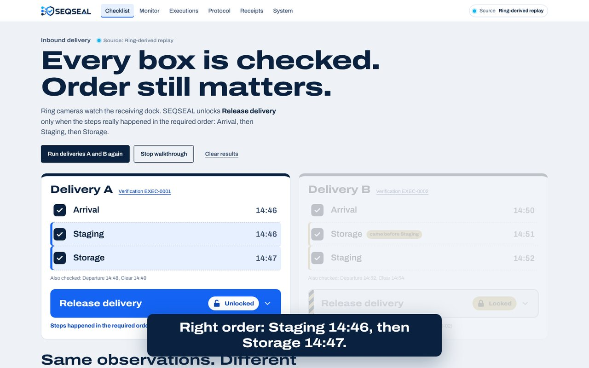
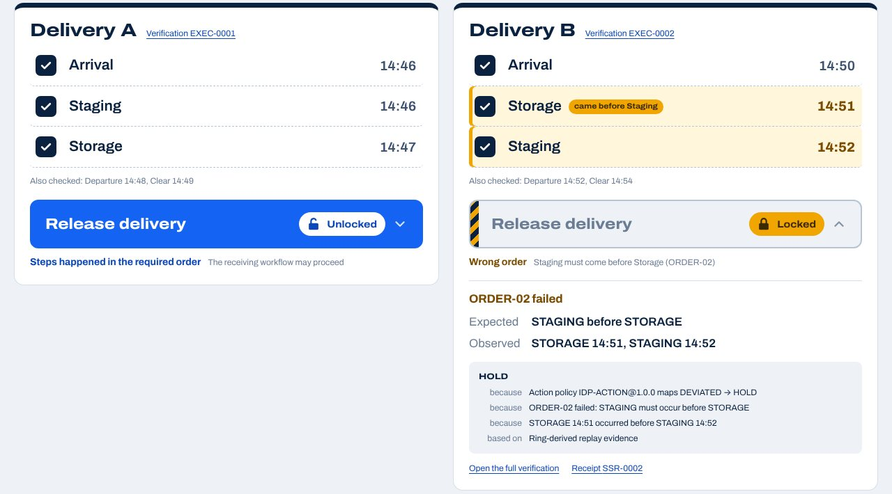
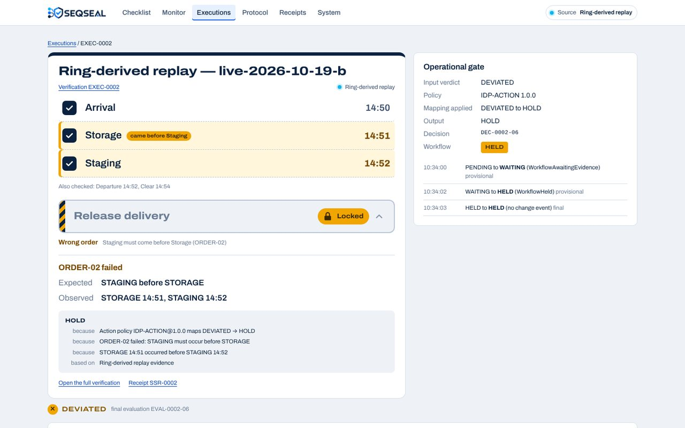
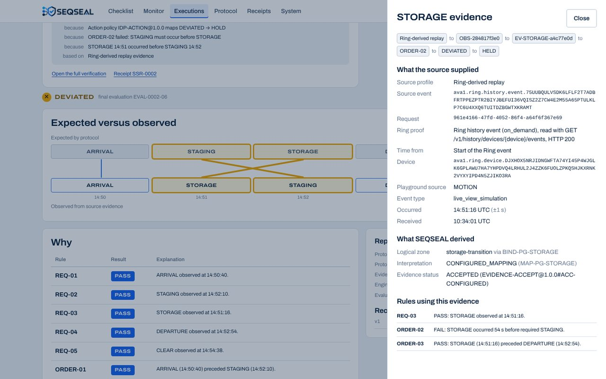
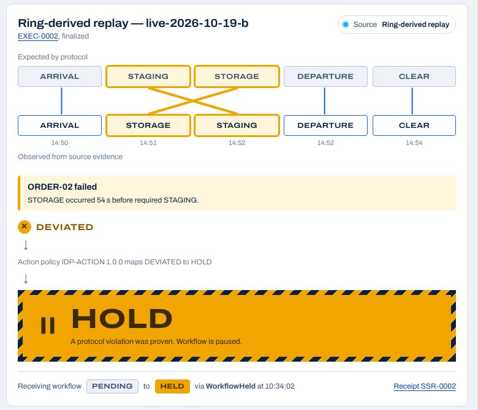
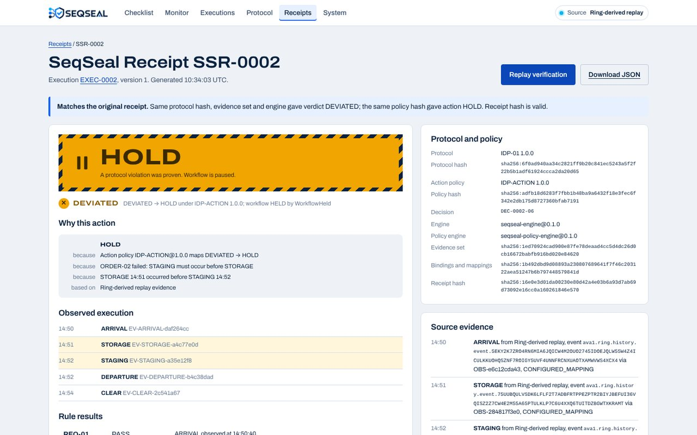
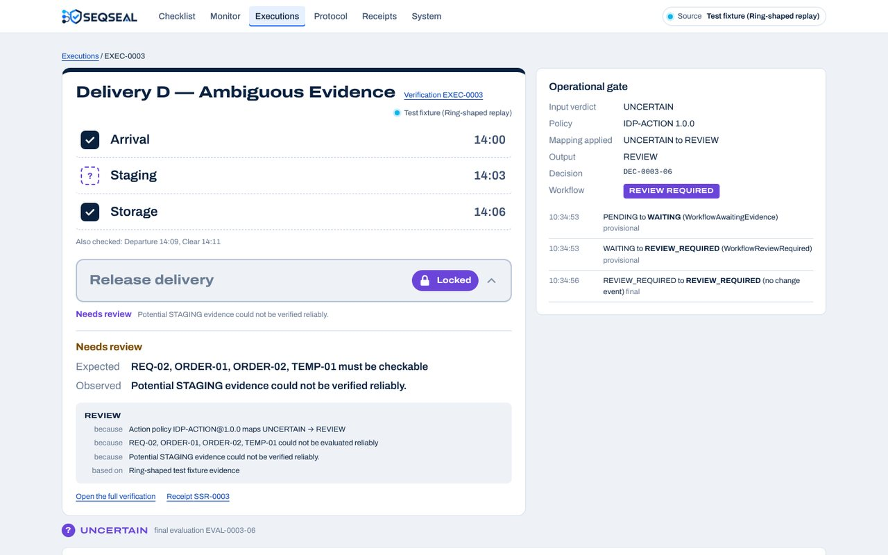
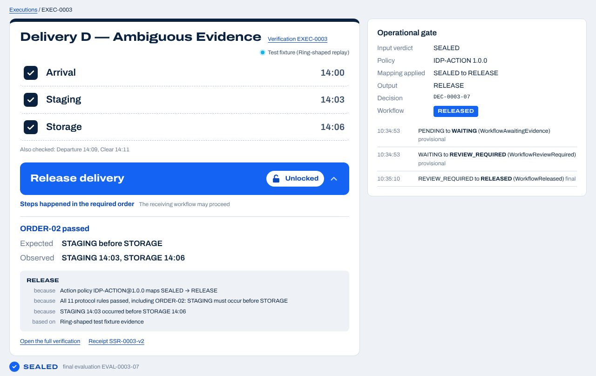
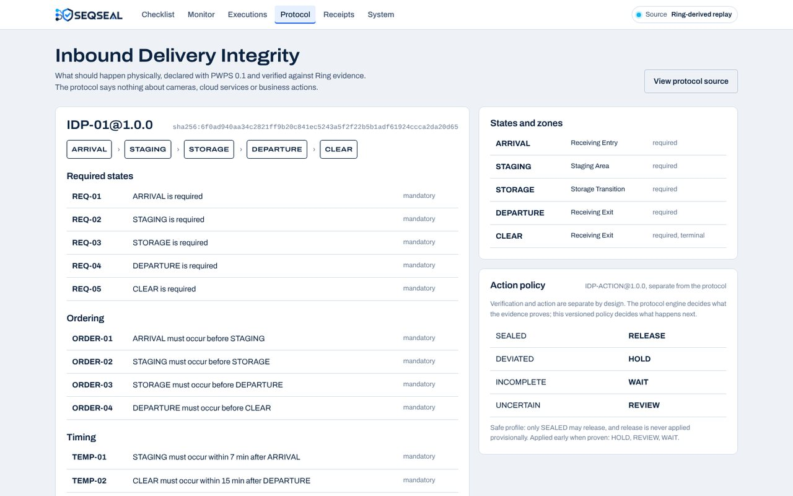
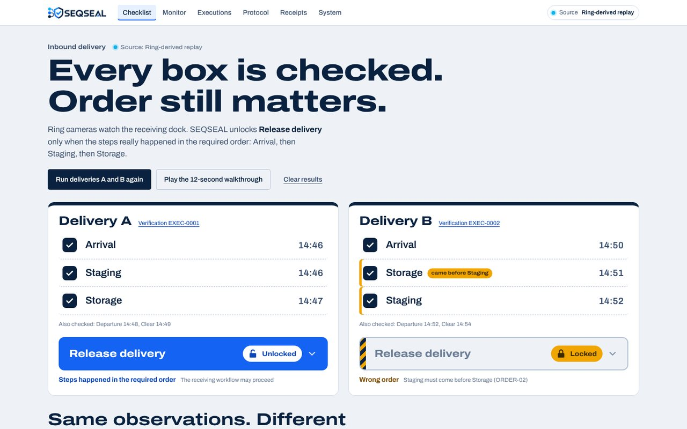

# Demo script

This is the shooting script for the 3-minute video. For each shot, it says what to open and click, what must be visible on screen, and the exact words to say.

The video opens with the Obvious Magic: a checklist where every box is checked and Release is still locked. It does not open with architecture, the receipt or the protocol (Master Brief §53). Every screen is the running application, and nothing on screen is staged.

What has actually been run, and what this script relies on:

| Date (UTC) | What | Result |
|---|---|---|
| 2026-10-19 14:46–14:55 | Live run through the Ring Developer Playground (`ring-spike.ts run --delivery A`, then `--delivery B`). Every step is a Ring history event | A: SEALED → RELEASE<br>B: DEVIATED → HOLD (ORDER-02, Storage 54 s before Staging) |
| 2026-10-19 15:05 | The two saved sessions `live-2026-10-19-a` and `-b`, replayed from the Monitor page and with `pnpm replay --captures` | same results, labelled Ring-derived replay; `tests/ring-live-sessions.spec.ts` pins them |
| 2026-10-20 | Every screen of this script, captured from the production build with those two sessions (the frames in `docs/demo/`) | labels and texts quoted below |
| every commit | Test fixtures (**Run deliveries A and B again**), `pnpm test:winning` (100 × A, 100 × B) and the benchmark | A released, B held |

## 1. The video at a glance

| Shot | Time | Length | On screen | Say (summary) |
|---|---|---|---|---|
| S1 | 0:00 | 12 s | Checklist page, the 12-second walkthrough | Every box is checked; why is Release locked? |
| S2 | 0:12 | 15 s | Delivery B: **Release delivery** opened, ORDER-02 failed | Same steps, wrong order, Release locked |
| S3 | 0:27 | 20 s | The live run: terminal, Ring Developer Playground, a box checking | Ring gives the checklist eyes |
| S4 | 0:47 | 28 s | Verification page, then the STORAGE evidence drawer | Deterministic engine; every step leads to a Ring event |
| S5 | 1:15 | 20 s | Monitor: DEVIATED → policy → HOLD → WorkflowHeld | Verdict and action are separate |
| S6 | 1:35 | 20 s | Receipt SSR-0002, **Replay verification** | Receipt, replayable |
| S7 | 1:55 | 25 s | Ambiguous evidence: Needs review, **Confirm evidence**, Unlocked | AI can propose evidence; it cannot release |
| S8 | 2:20 | 18 s | AWS architecture and Terraform | Event-driven AWS, no Bedrock in the decision path |
| S9 | 2:38 | 12 s | `pnpm pwps validate`, Protocol page | PWPS, open source |
| S10 | 2:50 | 10 s | Checklist: A unlocked, B locked | A checklist that can see |

Total: 3:00. The narration is about 350 words, read at about 120 words per minute, which leaves room for pauses.

The frames in `docs/demo/` come from the level 2 replay (label "Ring-derived replay"). At level 1 the label reads "Ring Developer Playground", and the times are those of your own run.

## 2. Prepare

### 2.1 Screen and tools

- **Screen recorder.** Use OBS Studio (or any screen recorder) at 1920 × 1080, 30 fps. Record the screen without sound, and record the narration afterwards from section 5. A free editor is enough (Clipchamp on Windows, DaVinci Resolve).
- **Browser.**
  - Use a separate window, full screen (F11), at 125 % zoom.
  - Hide the bookmarks bar, close every other tab, and turn notifications off.
- **Terminal.** Use Windows Terminal (it shows the ✓ of `pwps validate`), font size 18, in the repository folder.
- **SEQSEAL.** Run the production build. Development mode adds a Next.js badge in a corner of every page:

  ```bash
  pnpm install
  pnpm build && pnpm --filter @seqseal/web start      # http://localhost:3000
  ```

- **Determinism check.** Open http://localhost:3000 and press **Run deliveries A and B again** 10 times in a row. Each run must end with Delivery A **Unlocked** and Delivery B **Locked: Wrong order**. Then press **Clear results**.
- **Freeze the claims.** Run `pnpm benchmark --check`, tag `evaluation-freeze`, then tag `demo-final`. Record against `demo-final`.

### 2.2 Choose what data the video shows

| Level | What runs | Label on screen |
|---|---|---|
| 1 (preferred) | A live run through the Ring Developer Playground, just before filming (2.3) | Ring Developer Playground |
| 2 | The live run of 2026-10-19, replayed from the Monitor page (2.4) | Ring-derived replay |
| 3 | Test fixtures (**Run deliveries A and B again**) | Test fixture (Ring-shaped replay) |

Rules for the whole video:

- **One level only.** After a level 1 or level 2 run, do not press **Run deliveries A and B again** or any "Run …" button on the Monitor page, except in S7: they put test fixtures on screen.
- **Wording.**
  - Never call level 2 or level 3 "live".
  - Never say "real device" or "real camera" for Playground sources.
  - Never say Ring "detected" a vehicle, a package or motion: Ring's Playground events carry no class (FRICTION_LOG FL-006).

### 2.3 Level 1: the live run, recorded for S3

Arrange the screen for the recording that S3 uses:

- **Left half:** the Ring Developer Playground.
- **Right half:** the SEQSEAL checklist on top, Windows Terminal below.

Then:

1. Press **Clear results** on the checklist page.
2. In the Playground, generate a token. It lasts about 30 minutes, and both deliveries took 9 minutes on 2026-10-19.
3. In the terminal, set the token and the device id (the token is never written to disk):

   ```powershell
   $env:RING_PLAYGROUND_TOKEN = "<token>"
   $D = "<Playground device id>"
   ```

4. Start the screen recording, then run the two deliveries:

   ```powershell
   pnpm tsx scripts\ring-spike.ts run --device $D --post http://localhost:3000 --delivery A
   pnpm tsx scripts\ring-spike.ts run --device $D --post http://localhost:3000 --delivery B
   ```

For each step, the command prints which simulation to click ("Step 2 of 5, Staging: click PACKAGE in the Playground now"). Click it once in the Playground. The command waits for the Ring event, which Ring lists at the end of the clip (Vehicle about 22 s, Package about 32 s, Motion about 40 s). It then sends the capture to SEQSEAL and moves to the next step.

At the end of each delivery it prints SEQSEAL's result. On 2026-10-19:

```text
Delivery A (EXEC-0001): SEALED -> RELEASE, workflow RELEASED.
Delivery B (EXEC-0002): DEVIATED -> HOLD, workflow HELD.
  STORAGE occurred 54 s before required STAGING. (ORDER-02)
```

| Step | Click in the Playground | Delivery A | Delivery B |
|---|---|---|---|
| Arrival | Vehicle | 1st | 1st |
| Staging | Package | 2nd | **3rd** |
| Storage | Motion | 3rd | **2nd** |
| Departure | Vehicle | 4th | 4th |
| Clear | Motion | 5th | 5th |

What the command guarantees:

- **Steps from the configuration.** The steps come from the protocol and the mappings: A follows the expected sequence, and B swaps the two states of the signature rule.
- **Ring events only.** Every step is a Ring history event, and nothing falls back to a status probe. A click made before the step was shown does not count.
- **Deadlines.** It prints them, for example "Staging must start before 14:53:08 UTC (TEMP-01: within 7 min of Arrival)".
- **One delivery at a time.** It refuses to start B while A is open.
- **Resuming.** It stops without sending anything if no event comes after three waits or if the token expires. The same command then resumes where it stopped.
- **Network errors.** A dropped connection prints "network error … asking again", and the next poll retries.

If you need to start over: press **Clear results**, delete `fixtures\ring\captures\demo-a.jsonl` and `demo-b.jsonl`, and run again. Do not reuse the names `live-2026-10-19-*`, which hold the reference run.

### 2.4 Level 2: the live run of 2026-10-19, replayed

1. Press **Clear results** on the checklist page.
2. On the **Monitor** page, press **Replay Ring-derived session live-2026-10-19-a (5 captures)**, and wait about 10 s.
3. Press **Replay Ring-derived session live-2026-10-19-b (5 captures)**, and wait about 10 s.

If you want a clip for S3 at this level, record the screen during step 3.

### 2.5 Check before filming

- **Checklist page.** It shows the level's label, Delivery A **Unlocked** and Delivery B **Locked: Wrong order**.
- **Monitor page.** It shows Delivery B: ORDER-02 failed, DEVIATED, HOLD.
- **Receipts page.** It lists SSR-0001 (A) and SSR-0002 (B), and nothing else.

## 3. Shot by shot

The pointer moves slowly and stops on what the narration names. Each "Say" block is the exact text, followed by its word count.

### S1 · 0:00–0:12 · The Obvious Magic (12 s)



**Film**

1. Open the **Checklist** page. Deliveries A and B are side by side. Park the pointer in the empty area at the top right.
2. Start recording, wait 1 s, and click **Play the 12-second walkthrough**. Do not touch the mouse for 12 s.

**On screen**, in this order:

1. Delivery B: "Every box is checked." then "So why is Release still locked?"
2. B's Storage and Staging rows: "Wrong order: Storage 14:51, then Staging 14:52."
3. Delivery A: "Right order: Staging 14:46, then Storage 14:47." then "Release unlocked."
4. Both deliveries: "Right order → Release. Wrong order → Hold." then "SEQSEAL. A checklist that can see."

The captions use the times on screen; test fixtures show 14:03 and 14:06.

**Say** (23 words; first sentence at 0 s, second at about 1.5 s, third from about 3 s)

> Every box is checked. So why is Release still locked? Because seeing every step doesn't prove the process happened in the right order.

**Edit:** start the shot on the frame after the click.

### S2 · 0:12–0:27 · Same steps, different order (15 s)



**Film**

1. On the **Checklist** page, click the **Release delivery** button of **Delivery B** (right card, marked Locked).
2. The panel opens. Scroll down slowly until the whole Delivery B card is visible, including the panel.
3. Stop the pointer on the badge "came before Staging" when you say "Storage came before Staging".

**On screen**

- "ORDER-02 failed";
- "Expected: STAGING before STORAGE";
- "Observed: STORAGE 14:51, STAGING 14:52";
- the HOLD chain ("because Action policy IDP-ACTION@1.0.0 maps DEVIATED → HOLD …");
- Delivery A still **Unlocked** on the left.

**Say** (34 words)

> Delivery B went through the same five steps as A, under the same protocol and policy. But Storage came before Staging: ORDER-02 fails, and Release stays locked. Same observations. Different sequence. Different operational action.

### S3 · 0:27–0:47 · Ring gives the checklist eyes (20 s)

**Film:** nothing new. Use the recording made during the live run (2.3), cut into three pieces. Take the Staging step of Delivery A ("click PACKAGE"):

1. **About 4 s.** The terminal shows "Step 2 of 5, Staging: click PACKAGE in the Playground now", and the pointer clicks Package in the Playground.
2. **About 8 s.** The Package clip plays in the Playground. If you speed it up, show the factor on screen, for example "×3".
3. **About 8 s.** The terminal shows "[ok] Staging: Ring event … SEQSEAL accepted it." and the Staging box checks on the checklist. The label "Ring Developer Playground" stays visible.

**Say** (38 words)

> Ring gives the checklist eyes. Here, the footage is simulated by the Ring Developer Playground. Ring records each clip as an event in its history, and SEQSEAL binds every step of the delivery to one of those events.

**At level 2**, film the Monitor page while **Replay Ring-derived session live-2026-10-19-b** runs, then say (31 words):

> Ring gives the checklist eyes. These deliveries were captured live from the Ring Developer Playground on October 19. Every step is a Ring history event, replayed here through the same pipeline.

### S4 · 0:47–1:15 · Deterministic verification, down to the Ring event (28 s)




**Film**

1. In Delivery B's panel, click **Open the full verification**. The verification page of EXEC-0002 opens: the checklist card on the left, **Operational gate** on the right.
2. Scroll to **Expected versus observed**. The orange lines cross between STAGING and STORAGE. Hold 3 s.
3. Scroll to **Why**. Stop the pointer on the ORDER-02 row: "FAIL — STORAGE occurred 54 s before required STAGING." Hold 3 s.
4. Scroll back up and click the observed **STORAGE** box in **Expected versus observed**. The **STORAGE evidence** panel opens.
5. Move the pointer down "Source event" (the Ring event id), "Request" (the Ring request id), "Ring proof: Ring history event (on_demand)…" and "Time from: Start of the Ring event", about 1.5 s each.

**Say** (59 words; say the number of seconds shown in the ORDER-02 row: 54 for the 2026-10-19 run)

> The expected process is declared in PWPS. The engine lays the observed sequence over it and checks every rule deterministically: no model decides. ORDER-02 fails because Storage occurred fifty-four seconds before Staging. And every step leads back to its source: this one is a Ring history event, with its event ID, its Ring request ID and its start time.

### S5 · 1:15–1:35 · Verdict and action are separate (20 s)



**Film**

1. Close the panel and open the **Monitor** page. It shows the last delivery, B. Do not press any button on this page.
2. Scroll slowly down the left panel, from top to bottom:
   - the crossed lanes;
   - "ORDER-02 failed";
   - **DEVIATED**;
   - "Action policy IDP-ACTION 1.0.0 maps DEVIATED to HOLD";
   - the **HOLD** banner;
   - "Receiving workflow PENDING to HELD via **WorkflowHeld**".
3. Stop the pointer on "WorkflowHeld" for the last sentence.

**Say** (39 words)

> Verdict and action are kept apart. The engine says DEVIATED. A separate, versioned policy maps DEVIATED to HOLD, and SEALED to RELEASE. The Operational Gate then holds the receiving workflow, with a real WorkflowHeld event, not just a label.

### S6 · 1:35–1:55 · The SeqSeal Receipt (20 s)



**Film**

1. On the Monitor panel, click **Receipt SSR-0002** (bottom right). The page "SeqSeal Receipt SSR-0002" opens.
2. Show the HOLD banner and **Why this action**. Pass the pointer over the hashes under **Protocol and policy**.
3. Click **Replay verification**. The banner reads: "Matches the original receipt. Same protocol hash, evidence set and engine gave verdict DEVIATED; the same policy hash gave action HOLD. Receipt hash is valid." Hold 3 s.

**Say** (41 words)

> Every final decision produces a SeqSeal Receipt. It links the action to the policy, the verdict, the failed rule and the Ring evidence, each with its hash. Replay verification runs it again and finds the same verdict and the same action.

### S7 · 1:55–2:20 · AI can propose evidence, not release (25 s), filmed last




**Film**

1. On the **Monitor** page, click **Run ambiguous evidence**, then wait about 10 s. In the edit, keep only the click.
2. The Monitor panel now shows "Execution D — Ambiguous Evidence":
   - STAGING? with a dashed line;
   - "ORDER-02 not evaluable yet";
   - **UNCERTAIN**, then "Action policy IDP-ACTION 1.0.0 maps UNCERTAIN to REVIEW";
   - the purple **REVIEW** banner;
   - "Receiving workflow PENDING to REVIEW REQUIRED".

   Hold 3 s.
3. Click the execution link under the title (EXEC-0003 when A and B were the only runs before). The verification page opens, and its top right reads "Source: Test fixture (Ring-shaped replay)". Show:
   - Staging with a dashed "?" box, **Release delivery** "Locked", and "Needs review: Potential STAGING evidence could not be verified reliably.";
   - **Operational gate**: Input verdict UNCERTAIN, Output REVIEW, Workflow REVIEW REQUIRED.
4. Scroll to **Evidence**. On the row **STAGING?** ("AI_ASSISTED, AMBIGUOUS LOW", status UNCERTAIN), click **Confirm evidence**. The message reads "Evidence updated. The engine re-evaluated the protocol."
5. Scroll back to the top. Show:
   - Staging checked, **Unlocked**, and "ORDER-02 passed";
   - **Operational gate**: SEALED, RELEASE, "REVIEW_REQUIRED to RELEASED (WorkflowReleased)";
   - the link **Receipt SSR-0003-v2**.

**Say** (49 words)

> When Ring metadata isn't enough, an AI interpreter may propose evidence. In this test fixture it can't tell reliably whether Staging happened, so the delivery goes to review, not release. A supervisor confirms the evidence, never the outcome. The engine re-evaluates, releases the delivery, and issues a second receipt.

**Why last:** this test fixture becomes the newest delivery. When A and B come from Ring (levels 1 and 2), the Checklist and Monitor pages then show it instead of A and B. This was checked on 2026-10-19.

**Do not say** that Bedrock made this call. In the local demo, the interpreter is a deterministic stand-in: the **System** page reads "mock-evidence-interpreter@1 (fixture hints, no Bedrock call)".

### S8 · 2:20–2:38 · AWS (18 s)

**Film**

1. Open `docs/ARCHITECTURE.md` at **4. Runtimes › AWS** in the VS Code Markdown preview or on GitHub. Show the diagram: Ring webhook and Playground → API Gateway → EventBridge → SQS → Lambdas → DynamoDB and S3.
2. Show the `infrastructure/terraform` folder (`main.tf`, `modules/`).
3. Only after an actual `terraform apply`: show the Lambda functions or the CloudWatch dashboard in the AWS console.

**Say, not deployed** (33 words)

> SEQSEAL ships an event-driven AWS deployment as Terraform: each stage is a Lambda behind EventBridge and SQS. Bedrock is a side branch, and the roles that decide carry an explicit deny on Bedrock.

**Say, after `terraform apply`** (29 words)

> SEQSEAL runs on AWS: each stage is a Lambda behind EventBridge and SQS. Bedrock is a side branch, and the roles that decide carry an explicit deny on Bedrock.

### S9 · 2:38–2:50 · PWPS (12 s)



**Film**

1. In the terminal, type `pnpm pwps validate protocols/inbound-delivery.yaml`. It prints:

   ```text
   ✓ PWPS 0.1 valid  protocols/inbound-delivery.yaml
   Protocol: IDP-01@1.0.0
   States: 5
   Constraints: 11
   ```

2. Switch to the **Protocol** page. Show the ARRIVAL › STAGING › STORAGE › DEPARTURE › CLEAR sequence, the ORDER-02 row, and the **Action policy** table.

**Say** (21 words)

> And the protocol isn't hard-coded. It's written in PWPS, our open-source Physical Workflow Protocol Specification, with a validator and conformance tests.

### S10 · 2:50–3:00 · Close (10 s), filmed right after S2



**Film:** the **Checklist** page, with Delivery A **Unlocked** and Delivery B **Locked**. Collapse B's panel if it is open, and park the pointer outside the cards. Hold 10 s. In the edit, you can add a slow zoom on the two buttons and the SEQSEAL logo for the last 2 s.

**Say** (14 words)

> Ring observes. SEQSEAL verifies whether the workflow can proceed. A checklist that can see.

## 4. Filming order and editing

Film in this order, then put the shots back in timeline order (S1 to S10) in the editor:

| Order | Shots | Why |
|---|---|---|
| 1 | S3 | Recorded during the live run (2.3) |
| 2 | S1, S2, S10 | The Checklist page with A and B |
| 3 | S4, S5, S6 | Verification, Monitor and receipt of Delivery B |
| 4 | S9, S8 | Terminal and documentation; they do not depend on the data |
| 5 | S7 | Last: it puts a test fixture on the Checklist and Monitor pages |

Editing rules:

- **Cuts only.** Cut waits and page loads. Do not change what the screen shows.
- **Speed-ups.** Only in S3 and in S7's wait, and show the factor (×3) whenever footage is sped up.
- **Source label.** Keep it readable (top right, "Source: …") whenever deliveries are on screen.
- **Length.** The video ends at 3:00 at most.
- **Subtitles.** They are welcome; use the text of section 5.

## 5. Full narration (to record in one take)

> **[S1 · 0:00]** Every box is checked. So why is Release still locked? Because seeing every step doesn't prove the process happened in the right order.
>
> **[S2 · 0:12]** Delivery B went through the same five steps as A, under the same protocol and policy. But Storage came before Staging: ORDER-02 fails, and Release stays locked. Same observations. Different sequence. Different operational action.
>
> **[S3 · 0:27]** Ring gives the checklist eyes. Here, the footage is simulated by the Ring Developer Playground. Ring records each clip as an event in its history, and SEQSEAL binds every step of the delivery to one of those events.
>
> **[S4 · 0:47]** The expected process is declared in PWPS. The engine lays the observed sequence over it and checks every rule deterministically: no model decides. ORDER-02 fails because Storage occurred fifty-four seconds before Staging. And every step leads back to its source: this one is a Ring history event, with its event ID, its Ring request ID and its start time.
>
> **[S5 · 1:15]** Verdict and action are kept apart. The engine says DEVIATED. A separate, versioned policy maps DEVIATED to HOLD, and SEALED to RELEASE. The Operational Gate then holds the receiving workflow, with a real WorkflowHeld event, not just a label.
>
> **[S6 · 1:35]** Every final decision produces a SeqSeal Receipt. It links the action to the policy, the verdict, the failed rule and the Ring evidence, each with its hash. Replay verification runs it again and finds the same verdict and the same action.
>
> **[S7 · 1:55]** When Ring metadata isn't enough, an AI interpreter may propose evidence. In this test fixture it can't tell reliably whether Staging happened, so the delivery goes to review, not release. A supervisor confirms the evidence, never the outcome. The engine re-evaluates, releases the delivery, and issues a second receipt.
>
> **[S8 · 2:20]** SEQSEAL ships an event-driven AWS deployment as Terraform: each stage is a Lambda behind EventBridge and SQS. Bedrock is a side branch, and the roles that decide carry an explicit deny on Bedrock.
>
> **[S9 · 2:38]** And the protocol isn't hard-coded. It's written in PWPS, our open-source Physical Workflow Protocol Specification, with a validator and conformance tests.
>
> **[S10 · 2:50]** Ring observes. SEQSEAL verifies whether the workflow can proceed. A checklist that can see.

## 6. Submission story

> Every box can be checked and the physical process can still be wrong. SEQSEAL gives a receiving checklist eyes. Ring observes what actually happened. SEQSEAL verifies whether those steps occurred in the required order. Release only unlocks when the workflow is supported by sufficient evidence.
>
> Same observations. Different sequence. Different operational action.

For technical judges:

> Ring provides physical observations. PWPS defines expected execution. SEQSEAL builds traceable evidence and evaluates the sequence deterministically. A separate versioned policy converts the resulting verdict into an operational action. Both deliveries ran live through the Ring Developer Playground, every step bound to a Ring history event: A was released, and B was held because Storage came 54 s before Staging.

## 7. What the judge should remember

1. Every box is checked. Release is still locked.
2. Ring gives the checklist eyes.
3. AI can propose evidence. It cannot release the workflow.
4. Same observations. Different sequence. Different operational action.

## 8. Questions judges ask

| Question | Answer and where to show it |
|---|---|
| Is that actually Ring? | Read the source label and name the level honestly: Playground, Ring-derived replay or test fixture. At levels 1 and 2, every step is a Ring history event. The evidence drawer shows the event id, the Ring request id, "Ring proof" and "Time from". The ids of the 2026-10-19 run are in [ring-playground-observations.md](ring-playground-observations.md) §7. |
| Does Ring say it was a vehicle? | No. Playground events are `on_demand`, with an empty `cv_detections`. The operator declares each step's source and zone, and the drawer says so (FRICTION_LOG FL-006). A production integration maps the Ring webhook's detection subtype through the configured mappings. |
| Which protocol, which policy? | The **Protocol** page. Every receipt shows both, with their hashes. |
| What if a camera is offline? | The verdict is UNCERTAIN → REVIEW, never HOLD and never RELEASE (benchmark B08). |
| Can a reviewer just release it? | No. Reviewers confirm or reject evidence, and the engine re-evaluates (B23, B24). |
| Was the AI step Bedrock? | Not in the local demo: the **System** page shows the deterministic stand-in ("no Bedrock call"). On AWS, only the media interpreter may call Bedrock, and only to propose evidence. |
| What does HOLD do? | It stops the receiving workflow from proceeding automatically. It does not lock doors or stop machinery. |
| Biggest limitation? | One active delivery per lane: multi-delivery correlation is future work (BUILD_NOTES BN-015). In the Playground, the source of each step is declared by the operator. |
| What is open source? | `packages/pwps`: spec, schema, parser, validator, canonicalizer, hash, compiler, CLI, examples and conformance tests (Apache-2.0). |
